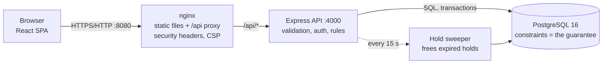
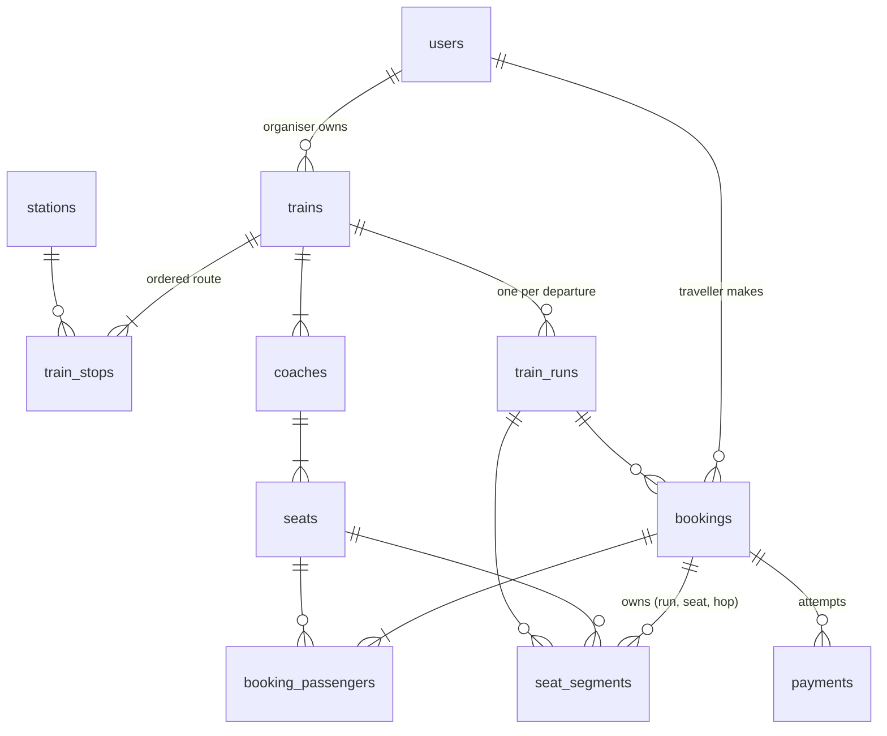

# 3. Architecture, 4. Data model, 5. The no-double-booking guarantee

## 3. Architecture and why each part exists



| Part | Why it is there |
|---|---|
| **React SPA** | Seat map, countdown and dashboards need a lot of client interaction. All business decisions are still made by the server, the client only displays them |
| **nginx** | Serves the built files and proxies `/api`, so the browser sees **one origin**. That lets the session cookie be `SameSite=Strict` and means CORS can stay switched off. Adds security headers and a strict Content-Security-Policy |
| **Express API** | Thin, explicit layers: *routes* (HTTP and validation) → *services* (rules, transactions) → *database*. Rules live in services, never in route handlers or the UI |
| **PostgreSQL** | Holds all state and **enforces the invariants itself** (primary key, unique indexes, check constraints, foreign keys). Even a bug in the API cannot sell a seat twice |
| **Hold sweeper** | A timer that releases expired holds. Correctness does not depend on it (holds are also freed lazily by the next buyer and by a late payment attempt), it just keeps data tidy |
| **Mock payment gateway** (`services/payment.js`) | One small function, deterministic outcomes, so success **and** failure can be demonstrated. Isolated so a real gateway replaces only this file |
| **Docker Compose** | One command runs db, backend and frontend with health checks, so anyone can run, test and inspect it |

Code layout inside the backend: `routes/` (parse, validate, call a service) → `services/` (bookings, availability, organiser, pricing, payment, holds) → `db/pool.js` (`withTx` runs a transaction and retries deadlocks).

## 4. Data model and why SQL



Key tables (full DDL in `backend/src/db/schema.sql`):

| Table | Purpose |
|---|---|
| `train_stops` | The route: `seq`, arrival/departure offsets in minutes from origin, cumulative km. Distance drives fares, offsets drive times |
| `seats` | One row per physical seat, generated from the coach class grid (row, column) |
| `train_runs` | One departure of a train on one date (`start_at`, status) |
| `bookings` | One booking: journey `from_seq`→`to_seq`, status `PENDING / CONFIRMED / CANCELLED / EXPIRED / FAILED`, amounts in paise, hold expiry, attempts, refund |
| `booking_passengers` | Name, age, gender, seat and fare of each traveller |
| **`seat_segments`** | **One row per (run, seat, hop)**, primary key `(run_id, seat_id, seg_idx)`. Exists for held and sold seats, deleted on expiry/cancel |
| `payments` | Every attempt: idempotency key, status, last-4 hint only. Unique `(booking_id, key)` and unique "one SUCCESS per booking" |
| `audit_log` | Who did what (hold, pay, cancel, run cancel) |

### Why PostgreSQL and not MongoDB

| Need of this problem | PostgreSQL | MongoDB |
|---|---|---|
| "This seat on this hop can have only one owner" | A **composite primary key** says it in one line and is checked atomically on every insert, even across thousands of concurrent transactions | No cross-document uniqueness for a set of keys. You would emulate it with one document per seat-hop plus a unique index, or multi-document transactions with retries, giving up the simple guarantee |
| Booking = booking row + passengers + seat claims + audit, all or nothing | Ordinary ACID transaction, rolls back everything if one seat is taken | Multi-document transactions exist but are the slower, less natural path |
| Data is **relational by nature** (users, trains, stops, seats, runs, bookings, payments) with foreign keys | Foreign keys stop orphans (a payment for a non-existent booking) | References are conventions, not enforced |
| Dashboard: revenue, refunds, occupancy per run, per day | Joins and `GROUP BY` over exactly this data, in one query | Aggregation pipelines with `$lookup`, more code and slower for joins |
| Money correctness | `CHECK (refund <= paid)`, `CHECK (status <> 'CONFIRMED' OR paid = amount)`, integer paise | Application-level only |
| Locking | Row locks (`FOR UPDATE`, `FOR SHARE`, `SKIP LOCKED`) for the hold/pay/cancel races | Not available in the same form |

MongoDB would be a fine choice for flexible, document-shaped data (e.g. a product catalogue). This is a strongly-structured, constraint-heavy, transactional problem, which is exactly what a relational database is for.

## 5. How two users never get the same seat

**The guarantee is a primary key, not application code.**

`seat_segments` has `PRIMARY KEY (run_id, seat_id, seg_idx)`. A journey from stop *a* to stop *b* owns hops `a … b-1` of a seat.
To hold seats the API runs **one transaction**:

1. lock the user row (serialises that user's own requests, enforces the 2-hold limit)
2. share-lock the run row (a run cancellation can't slip in between)
3. validate everything (route, cut-off, seats belong to this train)
4. free any expired holds on this run (`UPDATE … FOR UPDATE SKIP LOCKED`)
5. insert the booking, passengers
6. `INSERT INTO seat_segments … SELECT … ORDER BY seat, hop` for every seat × hop

If *any* other booking already owns *any* of those (run, seat, hop), PostgreSQL raises a unique violation, the **whole transaction rolls back**
(no half-held seats, no booking row) and the user gets `409 SEAT_UNAVAILABLE`.

```
User A: SBC→UBL seat 3B          User B: TK→DVG seat 3B           (same run)
  A owns hops 0,1,2                B wants hops 1,2
  INSERT (run,3B,0) ok             INSERT (run,3B,1) ← blocks until A commits
  INSERT (run,3B,1) ok             A commits → duplicate key → B rolls back → 409
```

If A and B race at the same instant, the database serialises them: the second insert **waits** for the first transaction, then fails with a duplicate key if the first committed
(or succeeds if the first rolled back, e.g. its payment failed and the hold was released).

Supporting design decisions:

| Concern | Solution |
|---|---|
| Deadlocks between racing multi-seat requests | Rows are always inserted in the same order (seat, hop). Remaining deadlocks (`40P01`) are retried automatically in `withTx` |
| Expired holds blocking a seat | Freed before inserting, with `SKIP LOCKED` so two requests never fight over the same expired booking |
| Payment vs expiry race | `pay` locks the booking row, then checks expiry **in SQL** (`hold_expires_at <= now()`), so one clock decides |
| Sold seats | The same rows stay in place when a booking turns `CONFIRMED`: no second copy of the truth to get out of sync |
| Cancel | Booking marked cancelled and its segments deleted in **one** transaction, so the seat returns to sale atomically |
| Lock order | Always run → booking rows, so no cycle |
| Reads | The seat map treats a segment as occupied if its booking is `CONFIRMED`, or `PENDING` with an unexpired hold. Expired holds therefore look free to everyone immediately |

Evidence: `booking.test.js` (30 users, one seat; 36 users, overlapping journeys), `tests/load.js` (150 users × 4 rounds of random holds, payments and releases, then database-wide invariant checks: no duplicate seat-hop, no segment owned by a dead booking, every confirmed booking owns exactly its hops).
